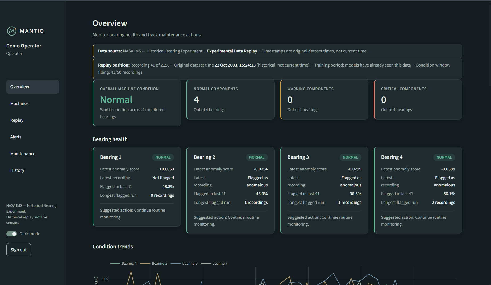
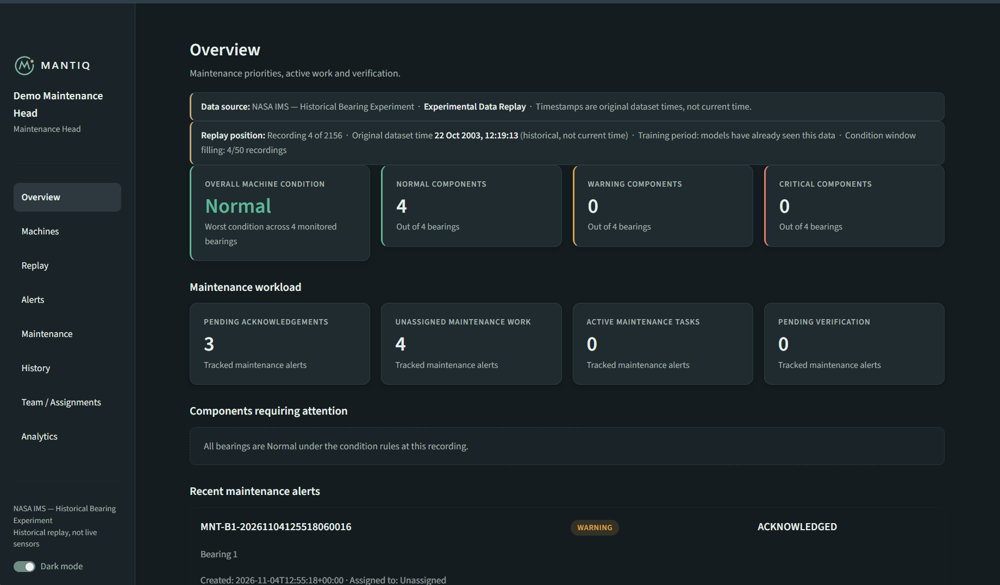
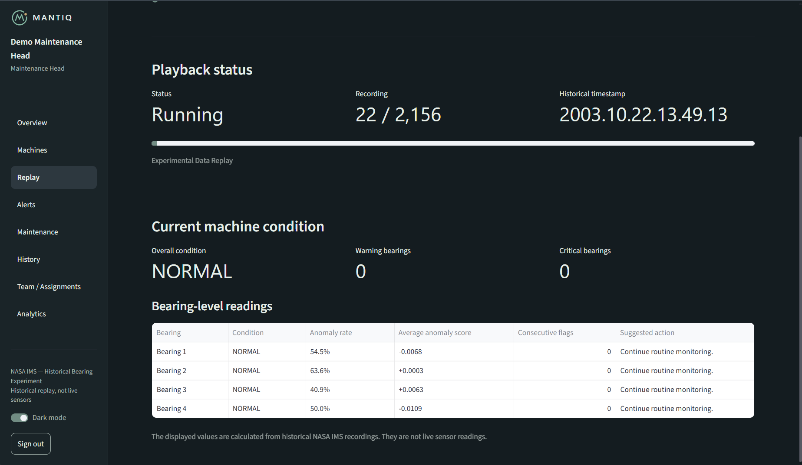
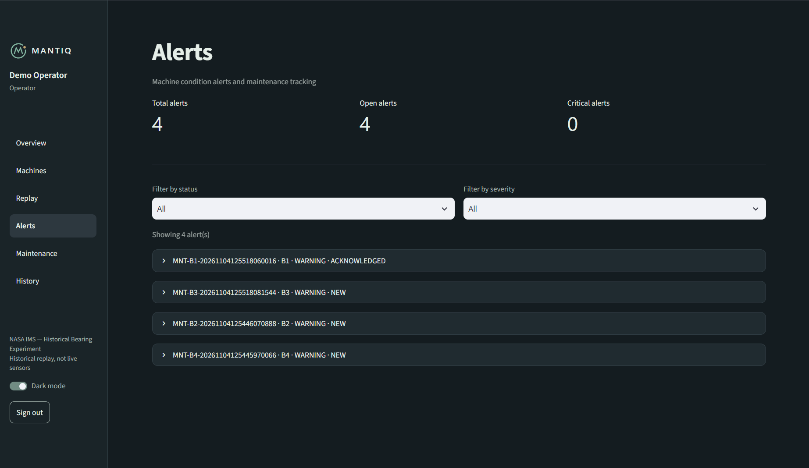

# MANTIQ — Action Before Failure

**An AI-assisted industrial maintenance platform that transforms machine-condition anomalies into trackable maintenance actions.**

MANTIQ is a prototype predictive-maintenance platform developed around rotating machinery and bearing-condition monitoring. It combines machine-learning-based anomaly detection, historical data replay, condition monitoring and a role-based maintenance workflow.

Rather than simply displaying abnormal readings, MANTIQ aims to connect machine-condition insights with human decisions, maintenance actions and verification.

> **Current prototype:** Uses historical NASA IMS bearing data. It does not connect to live industrial sensors or control machinery.

---

## 1. Problem Statement

Unexpected machinery failures can lead to production downtime, maintenance costs and operational disruption.

Traditional maintenance approaches often rely on fixed schedules or manual inspection. MANTIQ explores how machine-learning-based condition monitoring can help maintenance teams identify unusual vibration patterns and organize timely intervention.

## 2. Our Approach

MANTIQ processes historical bearing vibration recordings, extracts statistical features, applies anomaly-detection models and presents condition changes through an interactive dashboard.

The platform also provides a workflow for recording, assigning, escalating and verifying maintenance actions.

## 3. Key Features

- **Bearing condition monitoring:** Individual condition assessment for four bearings.
- **Machine-learning anomaly detection:** Bearing-specific Isolation Forest models.
- **Historical data replay:** Replay historical recordings and observe condition changes.
- **Condition classification:** Simplified NORMAL, WARNING and CRITICAL states.
- **Alert management:** Track alerts through acknowledgement, maintenance, resolution and verification.
- **Role-based dashboards:** Separate Operator and Maintenance Head workspaces.
- **Maintenance tracking:** Record operator findings, assign corrective actions and verify completion.
- **Condition analytics:** Visualize anomaly scores, condition trends and historical changes.

## 4. System Architecture

```text
NASA IMS Bearing Dataset
          |
          v
    Feature Extraction
          |
          v
  Processed Feature Dataset
          |
          v
 Bearing-Specific ML Models
       (Isolation Forest)
          |
          v
   Anomaly Scores and Flags
          |
          v
    Condition Assessment
          |
          v
 Historical Replay Engine
          |
          v
    Alert Management
          |
          v
 Operator <--> Maintenance Head
          |
          v
 Maintenance Resolution
      and Verification
```

## 5. Dataset

MANTIQ uses the **NASA IMS Bearing Dataset**, containing vibration measurements collected during bearing run-to-failure experiments.

Dataset characteristics used in this prototype:

- 2,156 recordings from the selected `1st_test` experiment.
- Four bearings.
- Two vibration channels per bearing.
- 20,480 samples per channel per recording.
- Sampling frequency: 20 kHz.
- Eight channels in total.

Each bearing is represented by two vibration channels.

### Dataset acquisition

The original raw dataset is not stored in this GitHub repository because of its size.

Download it from:

[NASA IMS Bearing Dataset](https://phm-datasets.s3.amazonaws.com/NASA/4.+Bearings.zip)

Extract the required `1st_test` experiment into:

```text
data/raw/IMS/IMS/1st_test/
```

The processed feature dataset and trained models are included in this repository, allowing the existing application to use the prepared artifacts without requiring raw-data extraction first.

## 6. Machine Learning Methodology

### Feature extraction

Five statistical features are extracted from each vibration channel:

- Root Mean Square (RMS)
- Standard deviation
- Peak absolute amplitude
- Kurtosis
- Crest factor

With two channels per bearing, each bearing is represented by ten features.

### Anomaly detection

A separate Isolation Forest model is trained for each bearing.

The training and evaluation workflow uses a chronological split:

- First 60% of recordings: training.
- Remaining 40%: testing.

Preprocessing statistics are learned from the training data and reused during scoring.

The trained model artifacts include the model, scaler, training medians and feature-column information.

### Condition assessment

Anomaly scores and flags are evaluated over a rolling window to derive simplified machine-condition states:

- NORMAL
- WARNING
- CRITICAL

The condition thresholds are prototype heuristics and have not been validated as universal industrial operating limits.

## 7. Technology Stack

| Area | Technology |
|---|---|
| Programming language | Python |
| Dashboard | Streamlit |
| Data processing | Pandas, NumPy |
| Machine learning | Scikit-learn |
| Model persistence | Joblib |
| Visualization | Plotly |
| Database | SQLite |
| Dataset | NASA IMS Bearing Dataset |

## 8. Project Structure

```text
MANTIQ/
├── app/
│   ├── components/
│   ├── database/
│   ├── pages/
│   ├── services/
│   ├── config.py
│   ├── main.py
│   └── theme.py
├── assets/
├── checks/
├── data/
│   └── processed/
├── models/
├── notebooks/
├── results/
├── src/
├── requirements.txt
└── README.md
```

## 9. Application Screenshots

### Operator Dashboard


### Maintenance Head Dashboard


### Historical Data Replay


### Alert Management



## 10. Installation and Execution

### Prerequisites

- Python 3.11 recommended.
- Git.
- Windows, Linux or macOS.

### Clone the repository

```bash
git clone https://github.com/vaishnaviupadhyay-ece/MANTIQ.git
cd MANTIQ
```

### Create a virtual environment

Windows PowerShell:

```powershell
python -m venv .venv
.venv\Scripts\Activate.ps1
```

Linux/macOS:

```bash
python3 -m venv .venv
source .venv/bin/activate
```

### Install dependencies

```bash
python -m pip install --upgrade pip
pip install -r requirements.txt
```

### Run the application

From the project root:

```bash
python -m streamlit run app/main.py
```

Open the local URL displayed in the terminal.

The prototype includes demonstration authentication. Use the demo credentials configured in `app/config.py`.

## 10. Important Limitations

MANTIQ is a research and demonstration prototype.

- The current data source is historical NASA IMS data, not a live factory connection.
- Anomaly detection does not guarantee failure prediction.
- Condition thresholds are heuristic and require industrial validation.
- The prototype does not estimate validated remaining useful life (RUL).
- No physical sensor integration or automatic machine shutdown is implemented.
- Demo authentication is not production-grade security.

## 11. Future Scope

- Integration with configurable vibration and temperature sensors.
- Edge-based anomaly detection.
- Machine-specific condition thresholds.
- Expanded testing across industrial machinery and datasets.
- Multilingual maintenance instructions in English, Hindi and Kannada.
- Integration with industrial IoT infrastructure.

## 12. AI Tools and Development Assistance

## AI Tools and Development Assistance

AI-assisted tools were used during the development of MANTIQ:

- **ChatGPT (OpenAI):** System architecture discussions, coding assistance, debugging, implementation guidance and technical documentation.
- **Claude (Anthropic):** Coding assistance, code review, debugging and development support.

AI tools supported the development process. Project implementation, integration, testing, model training and validation were carried out and reviewed as part of the development workflow.

## 13. Acknowledgements

- NASA IMS Bearing Dataset and its researchers.
- Open-source Python and machine-learning communities.

---

**MANTIQ — Action Before Failure.**